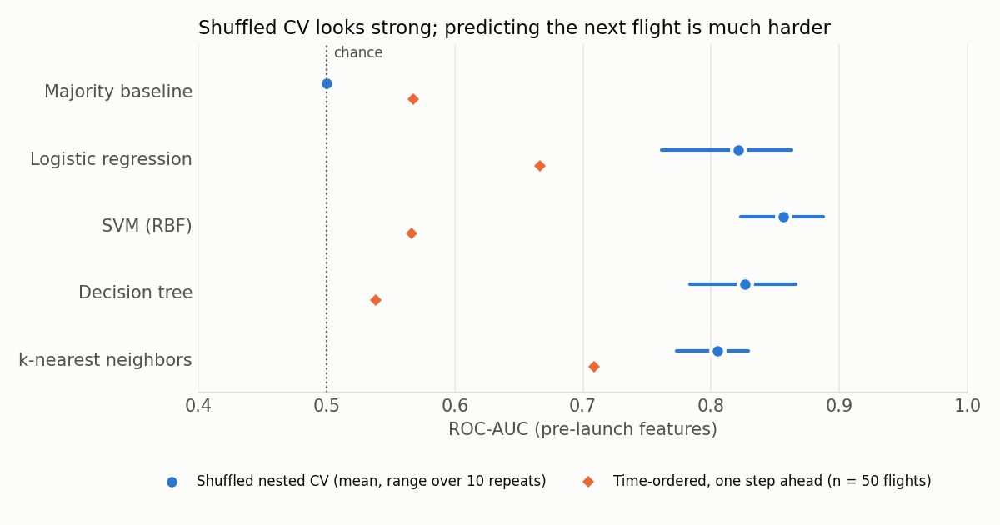

# Falcon 9 First-Stage Landing Prediction

Can information available before launch predict whether a SpaceX Falcon 9 first stage will land? A recovered booster is what makes a reused launch cheaper, so the question matters to anyone pricing a launch. This is my capstone for the IBM Data Science Professional Certificate, extended with leakage-controlled, time-aware evaluation.

## Key results

90 Falcon 9 launches (2010 to 2020), 60 of which landed (66.7%). All models use pre-launch features only.

| Evaluation | Model | Result | Baseline |
|---|---|---:|---:|
| Shuffled nested CV, ROC-AUC | SVM (RBF) | 0.856 (range 0.823 to 0.887 over 10 repeats) | 0.500 (majority class) |
| Shuffled nested CV, balanced accuracy | Decision tree | 0.821 | 0.500 |
| One step ahead, last 50 flights, accuracy | SVM (RBF) | 0.84 | 0.78 (always "landed") |
| One step ahead, last 50 flights, Brier score | SVM (RBF) | 0.138 | 0.204 (training landing rate) |



Shuffled cross-validation rewards models for learning that landings got more reliable over time. Trained only on earlier flights, the models still beat the baseline on accuracy and Brier score, but their ranking ability on the next flight (ROC-AUC 0.54 to 0.71) is much weaker than shuffled CV suggests.

## Approach

- **Data collection:** SpaceX REST API (static snapshot) with `requests` and `pandas.json_normalize`, and web scraping of a fixed Wikipedia revision with BeautifulSoup.
- **Leakage audit:** the course's `ReusedCount` is each booster's lifetime reuse count from the API, so it reveals the outcome. All 37 launches whose booster had `ReusedCount > 0` and flew again later in the data landed. `ReusedCount` and booster `Serial` are excluded.
- **Leakage-safe preprocessing:** median imputation, scaling and one-hot encoding live in a scikit-learn `Pipeline`, fit on training folds only. The course's full-data mean fill for 5 missing payload masses is undone first.
- **Nested cross-validation:** 10 repeats of stratified 5-fold outer CV, each with a 5-fold `GridSearchCV` inner loop, comparing logistic regression, RBF SVM, decision tree and k-nearest neighbors against a majority-class baseline.
- **Time-respecting validation:** expanding-window, one-step-ahead forecasts. Train on flights 1 to t, predict flight t + 1, for the last 50 flights.
- **Metrics for an imbalanced label:** ROC-AUC, balanced accuracy and Brier score alongside accuracy.
- **EDA and visualization:** SQL queries in SQLite, seaborn plots, a Folium map of launch-site proximity, and a Plotly Dash dashboard.

## Data

IBM Skills Network course extracts for the Applied Data Science Capstone (DS0321EN), built from the open-source [SpaceX API](https://github.com/r-spacex/SpaceX-API) and [Wikipedia](https://en.wikipedia.org/w/index.php?title=List_of_Falcon_9_and_Falcon_Heavy_launches&oldid=1027686922). The files in `data/raw/` are downloaded unchanged. Their URLs and SHA-256 checksums are in [`data/SOURCE_MANIFEST.json`](data/SOURCE_MANIFEST.json). IBM distributes them as course material without a separate license.

- **Unit of analysis:** one Falcon 9 launch (Falcon 1 excluded).
- **n:** 90 launches, June 2010 to November 2020.
- **Label:** `Class` = 1 if the first stage landed on a drone ship, landing zone or controlled ocean touchdown.

## Repository structure

```text
spacex_analysis.py          # feature sets, nested CV, one-step-ahead evaluation, figure
spacex_dash_app.py          # Plotly Dash dashboard (launch outcomes by site and payload)
data/raw/                   # course extracts
data/SOURCE_MANIFEST.json   # URLs and checksums
notebooks/
  01_data_collection_api.ipynb
  02_web_scraping.ipynb
  03_data_wrangling.ipynb
  04_eda_sql.ipynb
  05_eda_feature_engineering.ipynb
  06_launch_sites_folium.ipynb
  07_landing_prediction.ipynb
outputs/                    # metrics.json, model_comparison.csv, figures/
tests/test_analysis.py
archive/                    # superseded files from an earlier revision
```

## Reproduce

```bash
python3.12 -m venv .venv && source .venv/bin/activate
pip install -r requirements.txt
pytest -q
python spacex_analysis.py        # about 2.5 minutes; rewrites outputs/
cd notebooks && jupyter nbconvert --to notebook --execute --inplace 0[2-7]_*.ipynb
python spacex_dash_app.py        # dashboard at http://127.0.0.1:8050
```

Results are deterministic for a fixed environment (seed 2021).

## Limitations

- 90 launches is a small sample. Model differences of a few hundredths of AUC are within run-to-run noise, and the one-step-ahead test has only 11 non-landings.
- The data ends in 2020. Landings have since become routine, so the class balance and drivers no longer match current operations.
- `01_data_collection_api.ipynb` is shown without outputs: its per-launch lookups call `api.spacexdata.com`, which returned HTTP 522 on 2026-10-23. Its output, `dataset_part_1.csv`, is included in `data/raw/`.
- Folium maps don't render in GitHub's notebook preview. Open `06_launch_sites_folium.ipynb` in Jupyter or nbviewer.
